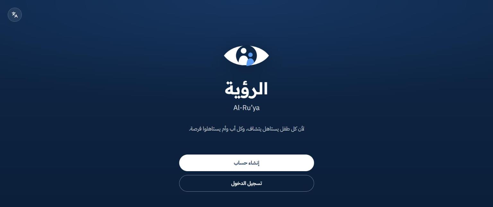
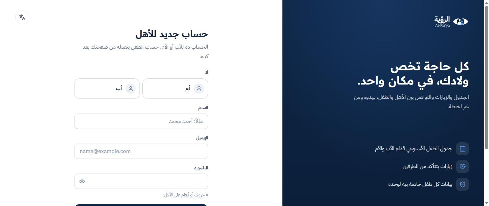
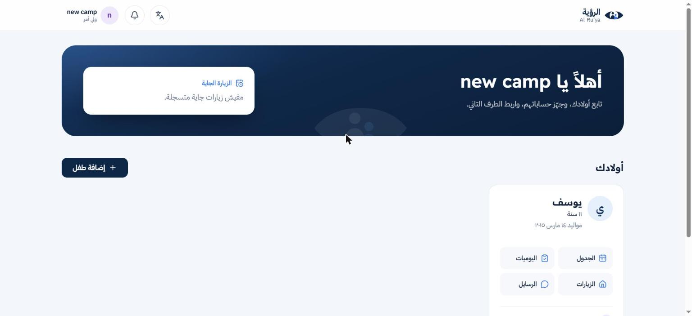
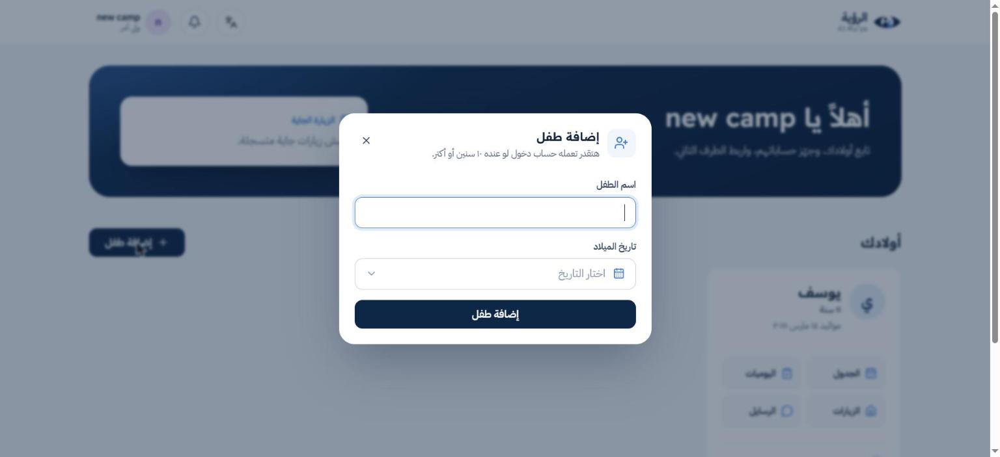
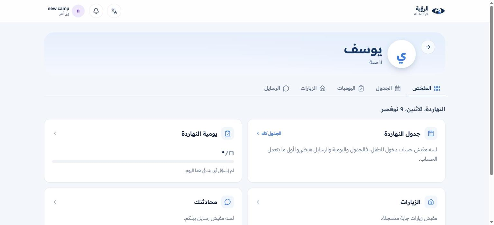
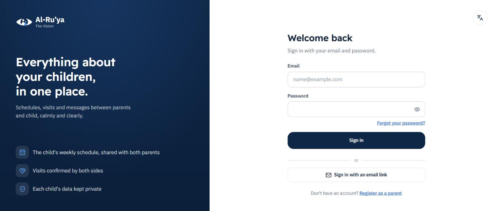

# الرؤية · Al-Ru'ya

**Organize children's visits and schedules after separation — calmly and clearly**

**تنظيم زيارات الأطفال وجدولهم بعد الانفصال — بهدوء ووضوح**

[Try it live — جرّب الموقع](https://al-ruya.vercel.app)

---

## What is Al-Ru'ya? — الرؤية يعني إيه؟

When parents separate, the child is often caught in the middle: Who has the child this weekend? Was the visit confirmed? How was the child's day?

Al-Ru'ya puts all of this in one calm place. Both parents see the child's week, visits are confirmed by both sides, and the child can keep in touch with each parent. Every child's information stays private.

لما الأب والأم بينفصلوا، الطفل غالبًا بيبقى في النص: مين معاه الطفل الويك إند ده؟ الزيارة اتأكدت ولا لأ؟ يومه كان عامل إزاي؟

الرؤية بتجمع كل ده في مكان واحد هادي. الأب والأم الاتنين بيشوفوا أسبوع الطفل، والزيارات بتتأكد من الطرفين، والطفل يقدر يفضل على تواصل مع كل واحد فيهم. وبيانات كل طفل خاصة بيه لوحده.

The site works in **Arabic and English** — switch any time from the language button at the top.

الموقع بيشتغل **بالعربي والإنجليزي**، وتقدر تغيّر اللغة في أي وقت من الزرار اللي فوق.

---

## How to use it — إزاي تستخدم الموقع

### 1. Create a parent account — اعمل حساب للأب أو الأم

Choose whether you are the mother or the father, then enter your name, email and password.

اختار إنت الأم ولا الأب، واكتب اسمك وإيميلك وباسورد.

### 2. Your home page — صفحتك الرئيسية

After signing in you see a welcome page with **your next visit** at the top and **your children** below.

بعد ما تدخل هتلاقي صفحة ترحيب، فوق فيها **الزيارة الجاية**، وتحت **أولادك**.

### 3. Add your child — ضيف طفلك

Click **"إضافة طفل" (Add child)** and write the child's name and date of birth. If the child is 10 or older, you can also create a login so they can use the site themselves.

دوس **"إضافة طفل"** واكتب اسم الطفل وتاريخ ميلاده. لو الطفل عنده 10 سنين أو أكتر، تقدر تعمله حساب دخول عشان يستخدم الموقع بنفسه.

### 4. Invite the other parent — ادعي الطرف التاني

From the child's card, click **"دعوة الطرف التاني" (Invite the other parent)**. They get a link by email, and from then on both of you follow the same child.

من كارت الطفل دوس **"دعوة الطرف التاني"**. هيوصله لينك على الإيميل، ومن ساعتها انتوا الاتنين بتتابعوا نفس الطفل.

### 5. Follow your child — تابع طفلك

Open the child's page to see everything in one place:

افتح صفحة الطفل وهتلاقي كل حاجة قدامك:

| Tab | What you see | التبويب |
| --- | --- | --- |
| Summary | Today at a glance: schedule, diary, visits and messages | **الملخص**: اليوم كله على بعضه |
| Schedule | The child's weekly schedule | **الجدول**: جدول الطفل الأسبوعي |
| Diary | What the child did today, with the time of each item | **اليوميات**: الطفل عمل إيه النهارده، وكل حاجة بوقتها |
| Visits | Every visit and its status — nothing is deleted, every change is recorded with who made it and when | **الزيارات**: كل زيارة وحالتها — مفيش زيارة بتتمسح، وكل تغيير متسجل بوقته وصاحبه |
| Messages | A private chat between you and your child | **الرسايل**: محادثة خاصة بينك وبين طفلك |

### 6. The child's side — من ناحية الطفل

The child signs in with their own account. They fill in their weekly schedule and their day, see their upcoming visits, and message each parent separately.

الطفل بيدخل بحسابه هو. بيكتب جدوله الأسبوعي ويومه، ويشوف زياراته الجاية، ويكلّم كل واحد من أهله لوحده.

### 7. Notifications — الإشعارات

The bell at the top tells you about new visits, schedule changes and messages.

الجرس اللي فوق بينبّهك بالزيارات الجديدة، وتغييرات الجدول، والرسايل.

---

## Ways to sign in — طرق الدخول

- Email and password — بالإيميل والباسورد
- A sign-in link sent to your email — بلينك يوصلك على الإيميل
- Forgot your password? Reset it by email — نسيت الباسورد؟ ترجّعه من الإيميل

---

## Built with — اتعمل بإيه

Next.js · React · TypeScript · Node.js · Express · MongoDB

---

Made by **Samaa Abo Diab** · [Portfolio](https://samaa-portfolio21.vercel.app) · [LinkedIn](https://www.linkedin.com/in/samaa-abo-diab)

© Samaa Abo Diab. All rights reserved.

